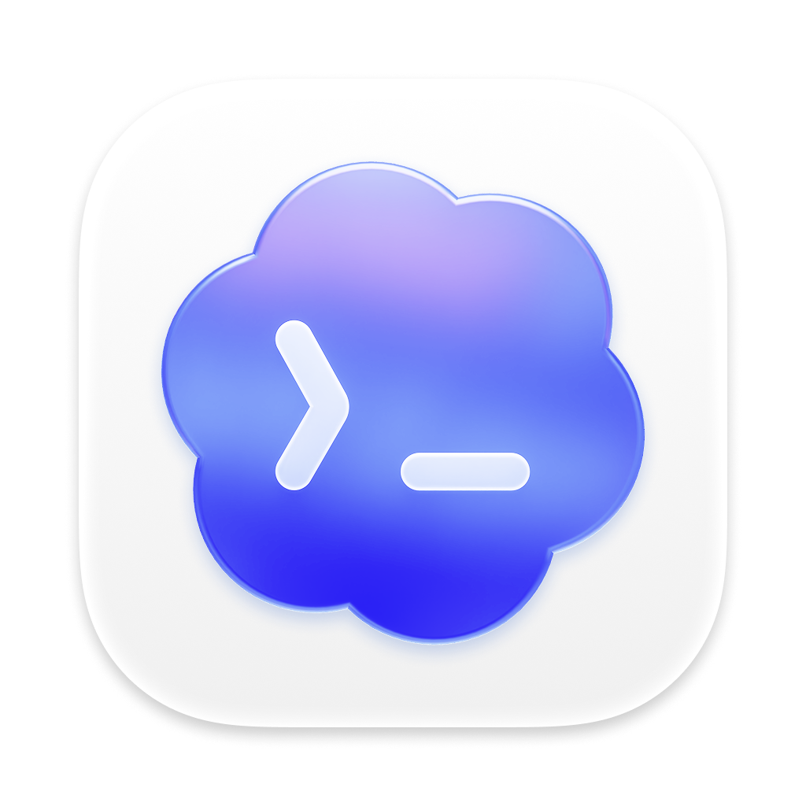

# AI Usage Widget

<p align="center">
  
  &nbsp;
  
  &nbsp;
  
  &nbsp;
  
</p>

macOS 바탕화면에 Codex·Claude·Grok·Cursor 구독 사용량을 붙여 두는 작은 위젯입니다.

사용량을 보려면 각 CLI를 열거나 statusline을 기웃거려야 했습니다. 이 위젯은 이미 로그인된 세션으로 HTTP usage API만 호출하고, `claude`나 `codex exec` 같은 프로세스를 띄워 로그를 만들지 않습니다. 패널은 바탕화면 아이콘 레이어에만 있습니다. 다른 앱 위로는 올라오지 않습니다.

> [!NOTE]
> 지금은 소스 공개입니다. 공증(notarized) 설치 패키지는 없습니다. 아래 명령을 복사해 로컬에서 빌드하세요. ad-hoc 서명이라 Gatekeeper가 막을 수 있습니다.

## 기능

- Codex 주간, Claude 5시간/주간/Fable, Grok 주간, Cursor 세션/주간을 한 패널에 표시
- 15분마다 HTTP로 갱신. 메뉴바에서 즉시 새로고침
- 바탕화면 아이콘 바로 위, 일반 앱 창 아래 (`desktopIconWindow + 1`)
- 모든 Space에 따라다님. 드래그로 위치 이동
- 로그인 후 유지되는 LaunchAgent (`local.aiusage.widgetkit.agent`, KeepAlive)
- Claude Code 키체인은 조회하지 않음. 암호 대화상자가 반복되는 경로를 넣지 않았음
- Cursor는 sqlite 토큰만 읽음
- 계정·광고·텔레메트리 없음. Native AppKit/SwiftUI, Electron 없음

## 요구 사항

- macOS 14 이상
- Xcode 또는 Xcode Command Line Tools
- 표시할 도구에 이미 로그인되어 있을 것

위젯은 자격 증명을 만들지 않습니다. 각 CLI/앱이 저장한 파일을 읽기만 합니다.

| 제공자 | 읽는 위치 |
| --- | --- |
| Codex | `~/.codex/auth.json` |
| Claude | `~/.claude/.credentials.json` (키체인은 조회하지 않음) |
| Grok | `~/.grok/auth.json` |
| Cursor | Cursor `state.vscdb`의 `cursorAuth/accessToken` |

Claude Code가 토큰을 키체인에만 두면 Claude 줄은 비어 있습니다. 파일로 옮겨 두면 위젯이 읽습니다.

## 빌드

터미널에 그대로 붙여 넣으세요.

```sh
git clone https://github.com/tinkerer0/ai_usage_widget_kit.git
cd ai_usage_widget_kit
./scripts/build.sh
open "dist/AI Usage Widget.app"
```

소스를 받고 Release로 빌드한 뒤 앱을 엽니다. 메뉴바에 `AI`가 생기고 바탕화면에 패널이 붙습니다.

`git`이나 `xcodebuild`가 없으면 먼저:

```sh
xcode-select --install
```

`/Applications`에 넣으려면:

```sh
cp -R "dist/AI Usage Widget.app" /Applications/
open -a "AI Usage Widget"
```

직접 xcodebuild를 쓰려면:

```sh
xcodebuild -project AIUsageWidgetKit.xcodeproj \
  -scheme "AI Usage Widget" \
  -configuration Release \
  -derivedDataPath build \
  CODE_SIGN_IDENTITY=-
```

산출물은 `build/Build/Products/Release/AI Usage Widget.app` 입니다.

## 조작

| 동작 | 결과 |
| --- | --- |
| 패널 드래그 | 위치 이동 |
| 메뉴바 `AI` → Show / Hide | 패널 표시/숨김 |
| 메뉴바 `AI` → Refresh (`⌘R`) | 지금 HTTP 갱신 |
| 메뉴바 `AI` → Settings… (`⌘,`) | 소스 설명과 새로고침 |
| 메뉴바 `AI` → Quit (`⌘Q`) | 종료 |
| 패널의 새로고침 버튼 | 같은 즉시 갱신 |

## 개인정보

자세한 내용은 [PRIVACY.md](PRIVACY.md)입니다. 보안 보고는 [SECURITY.md](SECURITY.md)로, 실제 토큰이나 로그인 화면 캡처는 넣지 마세요.

위젯은 계정을 만들지 않고, 사용량을 이 저장소로 보내지 않습니다. 요청은 각 제공자의 usage 엔드포인트로만 갑니다. 로컬 스냅샷 `~/Library/Application Support/AIUsageWidget/snapshot.json`에는 제공자 이름, 퍼센트, 리셋 시각만 있고 토큰은 없습니다.

설정에 넣는 OpenAI/Anthropic admin API 키는 위젯 전용 키체인 서비스 `AIUsageWidget`에만 저장됩니다. 넣지 않아도 구독 사용량 표시는 동작합니다.

패널 아이콘은 각 제품의 상표입니다. 소속·후원은 아닙니다.

## 상태

초기 오픈소스 macOS 프리뷰입니다. 지원되는 실행 방법은 소스에서 빌드하는 것입니다. ad-hoc 서명이라 다른 Mac으로 복사하면 Gatekeeper가 막을 수 있습니다.

## 기여·피드백

제가 이런 분야를 접한 지 얼마 안 돼서 부족한 점이 많습니다. 고칠 점이나 알려주실 내용이 있다면 issue나 PR로 남겨주시면 너무 감사하겠습니다.

## License

MIT. Copyright (c) 2026 tinkerer0.
